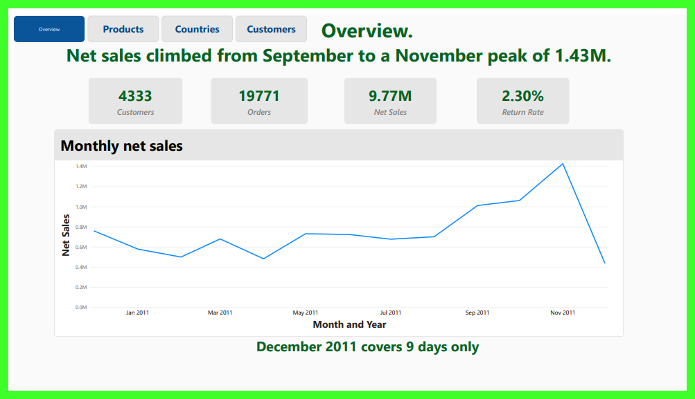

# Online Retail Sales Analysis: Cleaning, Profiling and Customer Insights in MySQL

An end-to-end SQL analysis of a UK online retailer's transactions (Dec 2010 to Dec 2011). The project profiles and cleans a messy transactional dataset with every decision documented and auditable, answers ten business questions on sales, returns, products, countries, customers and retention, and presents the results in a four-page Power BI dashboard.

**Status:** complete. Data profiling, cleaning, all ten business questions and the dashboard are done.



## Dataset

- **Source:** Online Retail II, UCI Machine Learning Repository
- **Size:** 541,910 transaction lines, 2010-12-01 to 2011-12-09
- **Columns:** Invoice, StockCode, Description, Quantity, InvoiceDate, Price, Customer ID, Country
- The CSV is not included in this repository. See `data/README.md` for how to download it.
- Currency isn't stated in the data. The retailer is UK-based, so values are probably pounds sterling, which is an assumption.

## Tools

- MySQL 8.0 (SQL: CTEs, window functions, conditional aggregation, joins)
- Power BI (four-page dashboard)
- Git and GitHub

## Approach: layered tables

The data is never modified in place. Each layer is built from the one before it.

| Layer | Table | Rows | Purpose |
|---|---|---|---|
| Raw | `online_retail_raw` | 541,910 | The file exactly as loaded, all text. Never changed. |
| Staging | `online_retail_stg` | 541,910 | Same rows with proper data types. |
| Flagged | `online_retail_flagged` | 541,910 | Staging plus an `exclusion_reason` for each excluded row. |
| Clean | `online_retail_clean` | 531,201 | The table used for analysis, with `is_cancellation` and `line_total`. |
| Lookup | `product_lookup` | 3,811 | One product name per StockCode. |

Rows are flagged with a reason instead of being deleted, so every exclusion can be counted and traced: 541,910 rows in, 10,709 excluded, 531,201 kept.

## Data cleaning decisions

| # | Finding | Rows | Decision |
|---|---|---|---|
| 1 | Non-product codes (postage, manual entries, fees, discounts, samples, bad-debt adjustments, vouchers) | 2,951 | Excluded, filtered by StockCode |
| 2 | Matched same-day reversal pairs (two customers, about 2.4% of gross product sales if left in) | 4 | Excluded |
| 3 | Zero price (internal stock adjustments and unpriced lines) | 2,497 | Excluded |
| 4 | Exact duplicates (all 8 columns identical) | 5,257 | Extra copies excluded, one kept. Worst-case sales impact about 0.21% |
| 5 | Cancellations (invoices starting with C) | 8,666 | Kept and flagged with `is_cancellation` so returns net correctly |
| 6 | Blank Customer ID (24.9% of raw rows) | 135,080 | Kept; limits customer-level analysis only |
| 7 | Several descriptions per StockCode | 212 codes | StockCode is the product key; names come from `product_lookup` |
| 8 | Country labels | 3 renamed | EIRE, RSA and USA standardized; Unspecified kept |
| 9 | Prices with 3 decimals | 4 | Staging uses DECIMAL(10,3) so nothing is rounded |

The evidence behind each decision is in `docs/decision-log.md`.

## Key findings

All figures are net of returns unless stated, and every query result is reconciled to a trusted total.

1. **Sales and returns.** Gross sales were 10,001,566.12 and returns 230,247.96, leaving net sales of 9,771,318.16. Returns equal 2.30% of gross sales.
2. **Seasonality.** Monthly net sales stayed between roughly 480K and 760K until August 2011, then climbed to 1.01M in September, 1.06M in October and a peak of 1.43M in November. This is consistent with seasonal demand ahead of Christmas, but the data doesn't state a cause. December 2011 has only nine days of data and isn't comparable.
3. **Geography.** The United Kingdom generates 84.75% of net sales. The next five countries (Netherlands, Ireland, Germany, France, Australia) contribute 10.86% together, and every other country is under 1%.
4. **Products.** The Regency cakestand 3 tier is the top product by revenue (164,459.49). Revenue is spread across 3,811 products, with the top 10 earning only about 8% of net sales. The top products by units are cheap items such as the popcorn holder and WW2 gliders, so revenue and volume rankings differ.
5. **Returns by product.** Measured by transaction lines, the overall return rate is 1.66% and the highest-returning products reach 10.7% to 16.2%. Measuring by units would have ranked a product first at 99.10% because of a single 9,360-unit cancellation, which is why lines are the more reliable measure.
6. **Customers and orders.** 4,333 identified customers placed 19,771 orders, and 6.9% of orders carry no customer ID. The average order is worth 505.87 but the median is 302.20, so a few very large orders lift the average.
7. **Concentration.** 234 customers (5.4% of the base) generate half of identified revenue, and the top 10% of customers generate 60.36%. No single customer exceeds 3.4%.
8. **Timing.** Thursday is the busiest day, Sunday the quietest, and there are no Saturday orders. Orders peak at noon, and the hours from 10:00 to 15:59 account for about 78% of orders.
9. **RFM segmentation.** Champions are 18.8% of customers but produce 63.2% of identified revenue, about 12 times the revenue per customer of the Lost segment. At Risk is small (20 customers) but consists of frequent buyers who have gone quiet.
10. **Retention.** Among the January to October 2011 cohorts, 14.8% to 23.5% of new customers bought again the next month, and retention stays in a band of roughly 17% to 30% afterwards instead of decaying. The December 2010 cohort isn't comparable because the data starts on 2010-12-01.

## Dashboard

A four-page Power BI dashboard built on summary tables exported from the verified SQL queries, so every number on it matches the findings above.

| Page | Shows |
|---|---|
| Overview | Net sales, return rate, orders and customers, with the monthly net sales trend |
| Products | Top 10 products by net revenue and by net units sold |
| Countries | Net sales by country (top 10) and the UK share |
| Customers | Customers, average and median order value, and share of customers vs share of revenue by RFM segment |

- **PDF version:** [`dashboard/online_retail_dashboard.pdf`](dashboard/online_retail_dashboard.pdf), viewable without Power BI.
- **Power BI file:** `dashboard/online_retail_dashboard.pbix`. In Power BI Desktop, Ctrl+click the navigator buttons to switch pages. The file reads the summary tables in `dashboard/data/` from the author's local paths, so it can be viewed but its data cannot be refreshed on another computer without repointing the sources.
- **Dashboard data:** `dashboard/data/` holds five small summary tables (monthly, country, product, RFM segment and headline numbers). The original dataset is not included.

## Business questions answered

| # | Question | Script |
|---|---|---|
| 1 | Gross sales, returns and net sales | `q01_gross_returns_net_sales.sql` |
| 2 | Monthly net sales trend | `q02_monthly_net_sales_trend.sql` |
| 3 | Net sales by country | `q03_net_sales_by_country.sql` |
| 4 | Top products by revenue and units | `q04_top_products.sql` |
| 5 | Product return rates | `q05_product_return_rates.sql` |
| 6 | Customers and order value | `q06_customers_and_order_value.sql` |
| 7 | Revenue concentration | `q07_revenue_concentration.sql` |
| 8 | Busiest days and hours | `q08_busiest_days_and_hours.sql` |
| 9 | RFM customer segmentation | `q09_rfm_segmentation.sql` |
| 10 | Cohort retention | `q10_cohort_retention.sql` |

## Repository structure

```
sql/            numbered pipeline scripts, run in order (01 to 10)
sql/analysis/   one script per business question (q01 to q10)
dashboard/      Power BI file, PDF export, screenshot and the summary tables it reads
data/           instructions for the dataset (the CSV itself is not committed)
docs/           supporting notes and the decision log
```

## How to reproduce

1. Download the dataset and place it as described in `data/README.md`.
2. Follow the setup notes at the top of `sql/01_load_raw.sql` (the file path must match your MySQL upload folder).
3. Run the scripts in `sql/` in numbered order. Each `validate` script lists the result it should produce.
4. Run the scripts in `sql/analysis/` to reproduce the findings.

## Limitations

- The data covers 13 months, so annual patterns (and customers who buy once a year) cannot be separated from one-off behaviour.
- December 2011 has only nine days of data.
- About a quarter of raw rows have no customer ID, so customer-level results cover identified customers only (84.6% of net revenue).
- Segment rules and retention definitions are analytical choices, documented in each script.

## Author

Michael Onojah ([@HonourJAH](https://github.com/HonourJAH))
